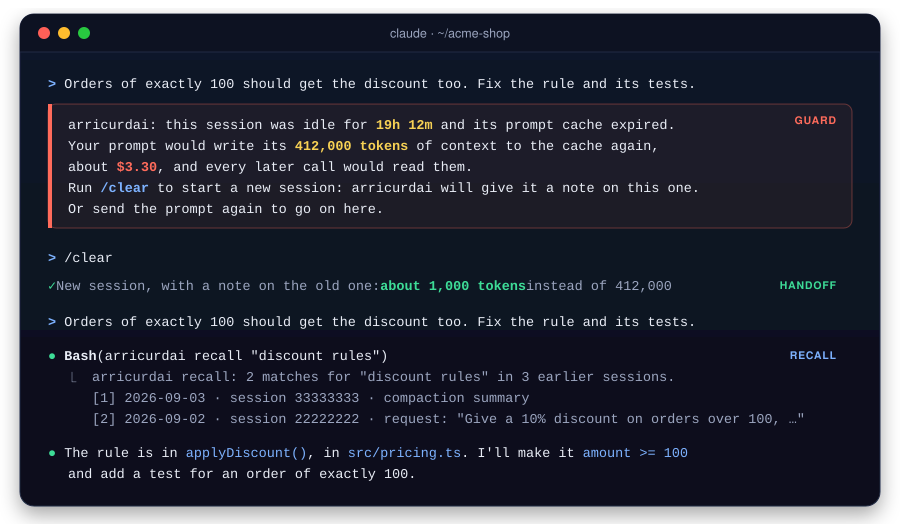
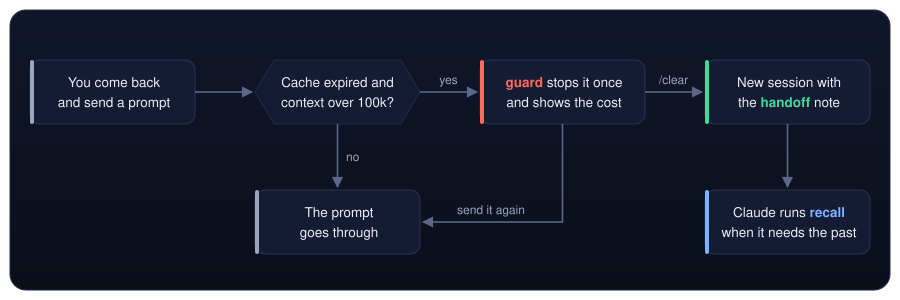
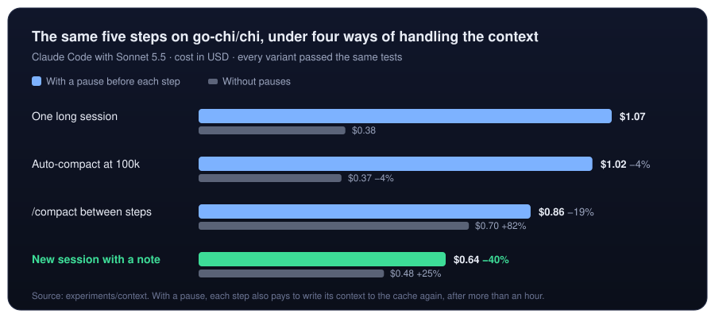

<div align="center">

<picture>
  <source media="(prefers-color-scheme: dark)" srcset=".github/assets/logo-dark.svg">
  
</picture>

# arricurdAI

### Stop paying twice for the same context.

Claude Code sends the whole conversation to the model on every call, and after an hour away it writes all of it to the cache again.<br>
arricurdAI shows where your tokens go and keeps the context small, **without losing what was said**.

[](#-get-started)
[](#-how-it-works)
[](#-privacy-and-safety)
[](#-privacy-and-safety)
[](LICENSE)
[](https://alessiodonato.github.io/arricurdai/)

[Why](#-why-sessions-get-expensive) ·
[How it works](#-how-it-works) ·
[Proof](#-proof) ·
[Get started](#-get-started) ·
[FAQ](#-faq) ·
[Reference](#-reference) ·
[🇮🇹 Italiano](#-in-breve-in-italiano)

<br>



</div>

<br>

## ✨ What you get

<table>
  <tr>
    <td width="33%" valign="top">
      <h3>📊 See where it goes</h3>
      <code>profile</code> prices every session and shows the blocks of context that carry the cost, what compacting at other moments would have saved, and the memory lines never used. <code>compare</code> shows what changed after a date, and estimates what each part did.
    </td>
    <td width="33%" valign="top">
      <h3>✋ No costly resume</h3>
      <code>guard</code> stops your first prompt to a large session whose cache expired, and tells you what going on would cost. One <code>/clear</code> and you start fresh.
    </td>
    <td width="33%" valign="top">
      <h3>📝 Keep the thread</h3>
      <code>handoff</code> gives the fresh session a note: your last requests, the files changed, the open tasks, the last reply and the earlier passages that match your prompt.
    </td>
  </tr>
  <tr>
    <td width="33%" valign="top">
      <h3>🔎 Nothing is lost</h3>
      <code>recall</code> lets Claude search earlier sessions for what was asked, decided and changed, so a small context is safe.
    </td>
    <td width="33%" valign="top">
      <h3>🔒 Stays on your machine</h3>
      No network calls, no telemetry, no model, no API key. It reads the transcripts Claude Code already keeps.
    </td>
    <td width="33%" valign="top">
      <h3>🙈 Secrets stay hidden</h3>
      Passwords, API keys, tokens and the passwords in connection strings print as <code>[redacted]</code>, so a search does not bring them back.
    </td>
  </tr>
</table>

### 🎯 Made for long sessions

If you keep a Claude Code session open for days, come back to it after lunch or the next morning, or watch a big refactor eat your usage, this is for you. Short sessions without pauses already cost little, and the guard never stops them.

## 💸 Why sessions get expensive

Claude Code resends everything it has read and said so far on every call. The prompt cache makes that cheaper, but not free, and it forgets after an hour. With Opus 5.5, at $4 per million input tokens, a session with **500,000 tokens** of context pays:

| | What happens | Cost |
| :-: | --- | --- |
| 📖 | Every call reads the whole context from the cache, at 0.05 of the input price. | about **$0.10 per call**, before the model writes a word |
| ⏸️ | After more than an hour away, the next prompt writes it all to the cache again, at twice the input price. | about **$4.00 at once**, as much as forty calls |
| 🆕 | A fresh session after `/clear` starts from the system prompt and a short note. | the old context is never written again, and every later call reads less |

> [!NOTE]
> Reading again what the agent already knew is a small cost: on three public repositories, at most 1.2% of it (see the [baseline](#baseline-on-public-repositories)). What costs is the **size of the context** and the **pauses**.

## 🔄 How it works

<div align="center">

</div>

| Piece | When it runs | What it does |
| --- | --- | --- |
| [`profile`](#profile-see-where-the-tokens-go) | When you run it | Where the cost of every session goes, and what other ways of compacting would have saved. |
| [`guard`](#guard-no-cache-rewrite-after-a-pause) | Hook, on every prompt | When the cache of a session over 100,000 tokens has expired, it stops your first prompt once and says what going on would cost. |
| [`handoff`](#guard-no-cache-rewrite-after-a-pause) | Hook, when a session starts | After `/clear`, a note on the old session. In every session, one line on how to run `recall`. |
| [`recall`](#recall-find-what-earlier-sessions-said) | Run by Claude | Searches the earlier sessions of the project, locally and without a model. |
| [`status`](#status-your-sessions-at-a-glance) | When you run it, or every minute in the menu bar | The sessions of the last hours, how large their context is and when their cache expires. |

<details>
<summary><b>📝 See the note a fresh session receives</b></summary>

<br>

This is the note `handoff` builds on the synthetic project in [`fixtures/`](fixtures), after the guard stopped the prompt *"Orders of exactly 100 should get the discount too. Fix the rule and its tests."*

```text
Note from arricurdai on the previous session, last active 2026-09-03T11:00:36.000Z. It was cleared after a pause so as not to write its 412,000 tokens of context to the cache again. Read files again when you need their content.

Last requests of the user:
1. The pricing tests fail on orders of exactly 100. Why?

Last reply of the assistant:
`computeTotals()` passes the subtotal straight to `applyDiscount()`, so the fix belongs in `src/pricing.ts`: use `amount >= 100`.

Earlier context that matches the prompt you were about to send:
arricurdai recall: 3 matches for "Orders of exactly 100 should get the discount too. Fix the rule and its tests." in 3 earlier sessions.

[1] 2026-09-03 · session 33333333 · compaction summary
This session is being continued from a previous conversation. Summary: the pricing rule uses amount > 100; orders of exactly 100 get no discount.

[2] 2026-09-03 · session 33333333 · request: "The pricing tests fail on orders of exactly 100. Why?"
The pricing tests fail on orders of exactly 100. Why?
The check uses `amount > 100`, so an order of exactly 100 gets no discount.

[3] 2026-09-02 · session 22222222 · request: "Give a 10% discount on orders over 100, and check how orders are queried."
Give a 10% discount on orders over 100, and check how orders are queried.
[Edit /home/dev/acme-shop/src/pricing.ts]
Orders over 100 now get 10% off in `applyDiscount()` and the tests pass. Orders are read in `listOrders()` in `src/db/orders.ts`.
```

</details>

<details>
<summary><b>🔎 See a recall search</b></summary>

<br>

On the same synthetic project:

```text
$ arricurdai recall "discount rules" --limit 2
arricurdai recall: 2 matches for "discount rules" in 3 earlier sessions.

[1] 2026-09-03 · session 33333333 · compaction summary
This session is being continued from a previous conversation. Summary: the pricing rule uses amount > 100; orders of exactly 100 get no discount.

[2] 2026-09-02 · session 22222222 · request: "Give a 10% discount on orders over 100, and check how orders are queried."
Give a 10% discount on orders over 100, and check how orders are queried.
[Edit /home/dev/acme-shop/src/pricing.ts]
Orders over 100 now get 10% off in `applyDiscount()` and the tests pass. Orders are read in `listOrders()` in `src/db/orders.ts`.
```

</details>

## 📈 Proof

<div align="center">

</div>

- 🏆 **After a pause, a new session with a note costs least: 40% less.** It does not write the old context to the cache again, and the agent lost almost nothing: it read two files again, 813 tokens.
- ⚖️ **Without pauses, starting fresh or compacting costs more than it saves** on contexts this small. That is why the guard acts only after a pause, and only on large sessions.
- 🔬 **The auto-compact limit never triggered.** The largest context stayed under 100,000 tokens, the smallest window Claude Code accepts. For long sessions, see [the result on one real project](#compare-see-what-changed).

The prompts, the acceptance tests and the scripts are in [`experiments/context`](experiments/context), so anyone can run it again.

### Baseline on public repositories

What does a project spend today on context it already knew? We ran five scripted Claude Code sessions on each of three well-known repositories and profiled them. The numbers use `r` = 0.1, the cache-read price before Claude 5 models.

| Repository | Area | Mean cost K | Read from cache | Rediscovery | S_max | Memory share of cost | Memory lines never used |
| --- | --- | --- | --- | --- | --- | --- | --- |
| [vitejs/vite](https://github.com/vitejs/vite) (TypeScript) | hot module replacement | 58,012 | 85% | 5.8% | 1.2% | 3.4% | 20 of 34 |
| [fastapi/fastapi](https://github.com/fastapi/fastapi) (Python) | dependency injection | 53,422 | 86% | 5.7% | 0.95% | 3.5% | 14 of 23 |
| [gin-gonic/gin](https://github.com/gin-gonic/gin) (Go) | routing | 43,754 | 86% | 4.1% | 0.51% | 4.5% | 15 of 23 |

*Commits `e954a9c`, `79cab5b` and `0f09c3a`, 26 October 2026, Claude Code 2.1.310.*

- **In short sessions on one area, rediscovery is small.** Between 4% and 6% of the tokens read as context were already known from an earlier session, and `S_max`, the ceiling on what avoiding them could save, stays at or under 1.2% of the cost.
- **The memory costs more than the rediscovery.** CLAUDE.md, loaded in every session, takes between 3.4% and 4.5% of the cost, and more than half of its lines with something to check were never used. The lines left unused describe the build, lint and test commands, which these sessions never ran, and the parts of each codebase they never touched. In this kind of work, the larger lever is choosing which memory enters the context.
- **These are measurements of today's spend, not of savings.** Five scripted sessions per repository are an example, not a statistic. Longer projects with real histories can rediscover much more, and the profiler measures them the same way.

<details>
<summary>How the sessions were run</summary>

<br>

The sessions come back to the same area of the code:

1. `/init`;
2. an explanation of the area;
3. a change, committed;
4. another change, committed;
5. a question.

They run on Sonnet, with the CLAUDE.md that `/init` wrote. The prompts and the script are in [`showcase/`](showcase), with the protocol and its limits, so anyone can run them again.

</details>

## 🚀 Get started

You need **Node 20+**.

```bash
# 1. install it
npm install -g arricurdai

# 2. see where a project's tokens go
arricurdai profile --project /path/to/your/project

# 3. turn on the hooks: it shows the changes and asks first
arricurdai setup
```

That's it: they apply to the Claude Code sessions you start afterwards. `arricurdai setup --remove` turns them off, and `--project /path/to/project` turns them on for one project only.

<details>
<summary>Prefer to edit the settings yourself?</summary>

<br>

Add the hooks to `~/.claude/settings.json`, or to `.claude/settings.local.json` for one project:

```json
{
  "hooks": {
    "UserPromptSubmit": [{ "hooks": [{ "type": "command", "command": "arricurdai guard" }] }],
    "SessionStart": [{ "hooks": [{ "type": "command", "command": "arricurdai handoff" }] }]
  }
}
```

</details>

> [!TIP]
> **Two optional settings make it work better.**
> - **A smaller context:** start Claude Code with `CLAUDE_CODE_AUTO_COMPACT_WINDOW=200000 claude`. This is a setting of Claude Code, and it works without arricurdAI. The [what if](#what-if) part of the report shows what that would have saved on your sessions, and `recall` finds what a compaction dropped.
> - **A longer history:** Claude Code deletes transcripts after 30 days. Set `"cleanupPeriodDays": 365` in `~/.claude/settings.json`, so that `profile` and `recall` see further back.

New here? The [guide](docs/guide.md) walks through every part of the profile report, and what to do with what it finds.

## 🔒 Privacy and safety

> [!IMPORTANT]
> - **Nothing leaves your machine.** arricurdAI reads the transcripts and runs `git log` locally. No network calls, no telemetry, no model. Each package has a test that fails if the package imports a module outside a short allowed list, so a network module cannot slip in.
> - **It only reads.** `profile`, `compare`, `status`, `recall` and the hooks read the transcripts and change nothing. The guard keeps one small state file in the system's temporary folder. `setup` is the one command that writes: only the hooks in your Claude Code settings, after showing you the changes and keeping a copy of the file.
> - **The hooks never trap you.** On any problem they let the prompt through, and the guard stops a prompt only once: send it again to go on.
> - **Secrets stay hidden.** Passwords, API keys, tokens and the passwords in connection strings print as `[redacted]`, so a search does not carry them into a new session.

## ❓ FAQ

<details>
<summary><b>Will the guard get in my way?</b></summary>

<br>

Only when three things are true at once: the session holds more than 100,000 tokens of context, its cache has expired because more than an hour passed since the last call, and you are sending the first prompt since. It stops that prompt once: send it again and it goes through. `guard --min-tokens <n>` changes the threshold.

</details>

<details>
<summary><b>What does Claude still know after <code>/clear</code>?</b></summary>

<br>

The note gives it your last three requests, the files changed, the open tasks, the last reply, and up to three passages of earlier sessions that match well the prompt you were about to send. Anything else, Claude finds with `recall` or by reading the files again. In the [experiment](#-proof), it read two files again: 813 tokens.

</details>

<details>
<summary><b>Does it send my code or my conversations anywhere?</b></summary>

<br>

No. It reads local files only, makes no network call and uses no model. See [Privacy and safety](#-privacy-and-safety).

</details>

<details>
<summary><b>Do I need arricurdAI to keep the context small?</b></summary>
<br>

No. A lower auto-compact window is a setting of Claude Code, and on long sessions it can do most of the saving on its own. arricurdAI adds what the setting does not do: `profile` and `compare` show whether it pays off on your sessions, `guard` stops the costly resume after a pause, and `recall` finds what a compaction left out.

</details>

<details>
<summary><b>Do I need an API key or an account?</b></summary>

<br>

No. Everything is computed from the transcripts with plain code. The costs come from the token counts Claude Code records.

</details>

<details>
<summary><b>Will it slow Claude Code down?</b></summary>

<br>

The guard reads only the end of the transcript. A recall search over tens of megabytes of transcripts takes under a second.

</details>

<details>
<summary><b>Which models does the guard know prices for?</b></summary>

<br>

Opus 5.5, at $4 per million input tokens, and Sonnet 5.5, at $2. For other models it gives the tokens without a price.

</details>

<details>
<summary><b>How do I turn it off?</b></summary>

<br>

Remove the two hooks from `settings.json`. arricurdAI changes nothing else in Claude Code.

</details>

## 📖 Reference

### Profile: see where the tokens go

```
arricurdai profile [--project <path>] [--sessions <n>] [--json] [--config <file>] [--transcripts <dir>]
```

| Option | Default | What it does |
| --- | --- | --- |
| `--project <path>` | current folder | The project to profile. |
| `--sessions <n>` | 20 | How many of the most recent sessions to measure. Older sessions are still used as history, so a re-read can be recognized. |
| `--json` | | Prints the report as JSON. The schema is `reportSchema`, exported by `@arricurdai/core`. |
| `--config <file>` | `arricurdai.config.json` in the project | The cost parameters (see [Parameters](#parameters)). |
| `--transcripts <dir>` | found from the project path | The project's transcript folder, when it cannot be found automatically. |

Claude Code keeps a project's transcripts in `~/.claude/projects/<project path with every non-alphanumeric character replaced by ->/`, or under `$CLAUDE_CONFIG_DIR` when that is set.

#### Example output

This is the output on the synthetic project in `fixtures/` (run `pnpm profile:fixtures` after `pnpm build`).

<details>
<summary>Show the report</summary>

```
arricurdai profile · ~/code/arricurdai/fixtures/acme-shop/project
Transcripts: ~/code/arricurdai/fixtures/acme-shop/claude-home/projects/-home-dev-acme-shop

Summary
  Sessions analyzed       3  2026-09-01 → 2026-09-03
  Mean cost K             55,728 price-weighted tokens per session
  Read from cache         84% of input tokens
  Rediscovery             29% of the tokens read as context
  S_max                   0.61% of the cost: a ceiling on savings, not a promise
  Memory loaded at start  238 tokens, rent 635 per session
  Memory share of cost    1.2%
  Lines skipped           5 of 109: 3 malformed, 1 of unknown type "future-feature", 1 "assistant" with missing fields

Top rediscoveries
   #  What                                             Times    Tokens      Cost
   1  src/checkout.ts                                      3       270       621
   2  src/pricing.ts                                       1        66       172
   3  search applyDiscount @ src                           1        57       143
   4  src/db/orders.ts                                     1        42        84

Memory lines never used in the last 3 sessions
  CLAUDE.md:6  Deploy with `scripts/deploy.sh --prod` from the main branch only.
  CLAUDE.md:7  The legacy `oldCheckout()` helper is deprecated; do not call it.
  docs/conventions.md:3  Validate request bodies with `zod` at API boundaries.
  .claude/CLAUDE.md:1  Never edit generated files under `src/generated/`.
  CLAUDE.local.md:1  My local database listens on port 5433 (`docker compose up db`).
  /home/dev/.claude/projects/-home-dev-acme-shop/memory/MEMORY.md:2  [Billing webhooks](billing.md) — Stripe events arrive in `src/billing/webhook.ts`
  src/db/CLAUDE.md:1  Queries must use the `withTransaction()` wrapper from `src/db/tx.ts`.
  2 lines have nothing to check, such as a rule of style. They are listed with --json.
```

</details>

The fixtures contain broken lines on purpose. The profiler counts them in "Lines skipped" and goes on.

The report ends with a fourth part, [where the cost goes](#where-the-cost-goes). It is left out here, because the usage numbers of the fixtures are invented and do not match their content.

#### How it measures

Every cost is in price-weighted tokens, that is, in units of the price of one input token. A **turn** is one API call: each call reads the whole context again, from the prompt cache.

##### Cost of a session

$$K_s = in + w \cdot cw + r \cdot cr + \mu \cdot out$$

- `in`, `cw`, `cr` and `out` are input tokens, cache writes, cache reads and output tokens, from the usage of each API call.
- A response that the transcript splits over several lines is counted once.
- `K_s` includes the session's subagents, and calls that only the session totals record, such as compaction.
- Writes to the 1-hour cache cost `w1h` instead of `w`. Claude Code main sessions write to the 1-hour cache and subagents to the 5-minute one. With `w1h = w` the formula is exactly the one above.

##### Rent of a block

A block of `c` tokens that enters the context at turn `t` of a session with `T` turns is written to the cache once, then read again on every later turn:

$$C = c \cdot (w + r \cdot (T - t))$$

A compaction drops the block from the context, so its rent stops there.

Memory that is always loaded (CLAUDE.md, MEMORY.md) enters at the first turn:

$$C_{mem} = c_{mem} \cdot (w + r \cdot (T - 1))$$

##### Rediscovery

A **context read** is a call to `Read`, `Grep` or `Glob`, or a Bash command that only reads (`cat`, `sed -n`, `head`, `tail`, `grep`, `rg`, `find`, `ls`). Its key is its kind (file, search or listing) and its target relative to the project root, so `cat src/a.ts` and `Read src/a.ts` match.

A read is a **rediscovery** when the same key was read in an earlier session of the project, and:

- for a file, the file has not changed since. The profiler checks both the edits in the transcripts and `git log` between the two reads;
- for a search or a listing, the result is identical.

A rediscovery costs the rent of its result.

##### Memory

The profiler measures the memory files Claude Code actually loaded, as the transcript records them:

- `~/.claude/CLAUDE.md`;
- `CLAUDE.md` and `CLAUDE.local.md` in the project and its parent folders;
- `.claude/CLAUDE.md` and `.claude/rules/*.md`;
- the files they import with `@`;
- the first 200 lines of the auto memory `MEMORY.md`.

For older transcripts that do not record this, it rebuilds the same list from disk and says so.

A memory line is **used** when one of its terms appears in a tool call or an assistant message of a measured session that loaded its file. The terms are code spans, paths, file names and link targets.

- Text the agent writes into a memory file, as `/init` does, is not a use.
- Lines with no such term, such as rules of style, are listed apart as "nothing to check", not as unused.

##### S_max

$$S_{max} = \frac{\sum \text{rent of rediscoveries}}{\sum K_s}$$

`S_max` is the share of the spend that went to rebuilding context from earlier sessions. It is a **ceiling**, not a promise:

- a memory that replaces a rediscovery also costs something;
- it does not count savings from pruning memory that is never used.

##### Load now or on demand

For each memory, the cost model can decide whether to load it at once or let the agent fetch it when needed. A block should be loaded now when

$$c < \frac{p \cdot (r \cdot L + overhead)}{(1 - p) \cdot (w + r \cdot (T - t))}$$

where `L` is the context already loaded and `p` the probability that the block is needed. Waiting is not free: a later fetch costs one more round trip, which reads the whole context again. The formula is `loadNowThreshold` in `@arricurdai/core`.

##### Parameters

The parameters live in `arricurdai.config.json`, in the project or wherever `--config` points. Every field is optional, and an unknown field is an error, so a typo does not go unnoticed.

| Parameter | Default | Meaning |
| --- | --- | --- |
| `w` | 1.25 | Price of writing to the 5-minute cache. |
| `w1h` | 2 | Price of writing to the 1-hour cache. |
| `r` | 0.05 | Price of reading from the cache: 0.05 for Claude 5 models, as the costs Claude Code records show. Set 0.1 for older models. |
| `mu` | 5 | Price of an output token. |
| `overhead` | 300 | Tokens of one extra round trip: the tool call, its result and the reply. |

All prices are relative to the price of one input token.

```json
{ "w1h": 2, "overhead": 400 }
```

##### Where the cost goes

The last part of the report splits the measured cost of every session among the blocks that made it up. The blocks are:

- the replies;
- the thinking;
- each tool result;
- the prompts;
- the memory files;
- the text Claude Code adds;
- the system prompt and tools.

The parts add up to the measured cost exactly:

- **Cache reads** of each call are split among the blocks already in the context, in proportion to their size. That is the rent a block pays for staying.
- **Input and cache writes** of a call go to the blocks that entered just before it.
- **Block sizes** are estimated from their text, then calibrated on how much the context really grew between two calls, which the usage measures exactly. Thinking is sized from the usage, and images from their pixels.
- **The prefix.** At the first call, what the blocks do not explain is the system prompt, tools and skills. After a compaction or a rewind, it is the context carried over.
- **A cache rebuild** is a call that wrote the previous context to the cache again instead of reading it, as happens after a pause longer than the cache lifetime. The extra cost is a line of its own.
- **Writing output** costs `mu` per token.

<details>
<summary>An example from the <a href="showcase">showcase</a>: five short sessions on <code>gin-gonic/gin</code></summary>

```
Where the cost goes
  What                                                  Tokens          Cost   Share
  Writing output                                                      58,245     27%
  Text added by Claude Code                             27,899        57,731     26%
  Tool results: Bash                                    22,794        50,619     23%
  System prompt, tools and skills                       43,830        20,467    9.4%
  Memory files                                           8,403        16,297    7.4%
  Assistant replies and tool calls                       3,977         8,274    3.8%
  Your prompts                                           1,765         4,163    1.9%
  Tool results: Read                                     1,058         2,223    1.0%
  … 2 more under 1.0% each, with --json
  Known blocks explain 100% of the cost; the rest is context the transcript does not record.

   #  Most costly blocks                                Tokens   Turn   Kept         Cost
   1  Bash: sed -n 340,410p gin.go; sed -n 685,815p…     5,300      3      2       11,662
   2  Bash: sed -n 253,420p tree.go; sed -n 420,676…     4,885      3      2       10,748
   3  Bash: ls -a; ls .github .cursor* 2>/dev/null;…     3,206      2      5        8,017
   4  Claude Code: skill_listing                         2,964      1      6        7,705
   5  Claude Code: skill_listing                         2,992      1      4        7,179
   6  System prompt, tools and skills                    9,197      1      6        6,880
   7  Claude Code: skill_listing                         2,961      1      3        5,804
   8  Claude Code: skill_listing                         3,494      1      2        5,666
   9  Claude Code: skill_listing                         3,025      1      2        5,535
  10  System prompt, tools and skills                    8,661      1      4        4,864
  Turn: the API call where the block entered the context. Kept: the calls that read it again.
```

</details>

In sessions this short, most of the cost is output, the commands' results and the text Claude Code adds to every session. The list of skills alone is about 3,000 tokens. In long interactive sessions the picture changes:

- blocks stay in the context for hundreds of calls;
- thinking stays in the context too;
- every pause longer than the cache lifetime writes the whole context again, at the price of a cache write.

##### What if

When sessions are long, the report replays them with compactions at other moments, to show what the context size costs:

- **Compact before each pause.** Before every cache rebuild, while the cache is still warm. This is what you could do by running `/compact` before a long break.
- **Compact when coming back from a pause.** At every cache rebuild, reading the cold context at the cache-write price.
- **Keep the context under 200,000 or 400,000 tokens.** Compact whenever a request would pass that size, as a lower auto-compact window would.

How the replay works:

- **A simulated compaction** keeps the system prompt and a summary as large as the real summaries of the project, or 15,000 tokens if there is none. It costs a read of the context and the writing of the summary.
- **The calls that follow** bring the same new content as the real ones, with a smaller context.
- **These are ceilings.** A compaction drops detail the agent may have to read again, and that cost is not counted.

##### What is approximate

- Token counts are estimates: characters / 4, computed in one function (`estimateTokens`) so that a tokenizer can replace it.
- A Bash command that reads several files splits its output evenly among them.
- git only sees committed changes. A file edited outside Claude Code and never committed looks unchanged. Without git, the report says so.
- Only rediscoveries across sessions are counted, not re-reads within one session.
- The breakdown assumes every block stays until the next compaction or rewind. Claude Code can also clear old blocks on its own, which the transcript does not record.
- Costs are in price-weighted tokens of each call's own model. A session that switches model mixes prices, and starts again from an empty cache.
- The transcript format belongs to Claude Code and is not documented. [docs/transcript-schema.md](docs/transcript-schema.md) records what was observed in versions 2.1.301 and 2.1.310. Lines the parser does not understand are counted and skipped.

### Guard: no cache rewrite after a pause

The prompt cache keeps the context of a main session for an hour. After a longer pause, the next prompt writes the whole context to the cache again, at twice the input price, and every later call reads it. In long sessions these rewrites are a large part of the cost. In the [context experiment](#-proof), with a pause before each step, a new session per step with a short note cost 40% less than one long session, and both passed the same tests.

Two hooks act on it:

- **`arricurdai guard`** runs when you send a prompt. If the cache of a session larger than 100,000 tokens has expired, it stops the prompt once and says what going on would cost. Run `/clear` to start fresh, or send the prompt again to go on. `--min-tokens <n>` changes the smallest session worth stopping for.
- **`arricurdai handoff`** runs when a session starts. After that `/clear`, it gives the new session a note on the old one, built from the transcript without a model: the last requests, the files changed, the open tasks and the last reply. Temporary files are counted for each folder, not listed. It adds up to three passages of earlier sessions that match the prompt you were about to send, about 800 tokens at most: only those whose excerpt holds at least 40% of the prompt, rare words weighing more, so that a loose match does not fill the note with noise. In every new session, and after a compaction, it adds one line on how to run [`recall`](#recall-find-what-earlier-sessions-said).

The settings are in [Get started](#-get-started). Both hooks read local files only, and on any problem they let the prompt through.

### Recall: find what earlier sessions said

A small context is cheaper, but the agent loses what it no longer sees. `arricurdai recall` lets it look that up:

```sh
arricurdai recall "invoice vat foreign customers" --project /path/to/project
```

Claude runs it on its own: the handoff hook tells every new session how. It searches the earlier Claude Code sessions of the project and prints the few passages that match. Each passage comes from one of these:

- a request with the replies to it;
- the files changed after the request;
- a part of a compaction summary.

How it works:

- **The search is lexical (BM25), without a model.** It reads local files only.
- **Matches across word forms.** It folds singular and plural in Italian and English, so `fattura` finds `fatture`, and it splits identifiers such as `MethodAllowList`.
- **Shows the line that matters.** Each passage is the line that holds the rarest words of the query, with whole lines around it.
- **Says each thing once.** A passage that repeats one already shown is left out for the next match: successive compaction summaries repeat each other.
- **Reads pasted prompts too.** A request that was pasted text, or that starts with an image, counts as a request, and is marked as pasted.
- **What it leaves out.**
  - Tool results: the files they show can be read again.
  - The current session: when Claude Code runs the command, it already has that session.
- **Hides secrets.** Passwords, API keys, tokens and the passwords in connection strings print as `[redacted]`, so a search does not bring them into a new session. A value recognized once is hidden everywhere in the project, even with no key next to it, and the note after `/clear` hides secrets the same way. It works by patterns: a password that never appears next to a word like "password" can still show.

| Option | Default | What it does |
| --- | --- | --- |
| `--limit <n>` | 5 | The most passages to show. |
| `--max-tokens <n>` | 1500 | The most tokens to print. The first passage is always printed. |
| `--json` | | Prints the passages as JSON. |
| `--project <path>`, `--transcripts <dir>` | current folder | As for `profile`. |

Limits:

- **It sees only the transcripts Claude Code keeps.** By default Claude Code deletes them after 30 days. To search further back, raise `cleanupPeriodDays` in `~/.claude/settings.json`.
- **It works best with precise words.** It finds names, paths, errors and technical terms well. It does less well with vague questions.
- **It always prints the best matches it has.** With a vague query, they can be only loosely related.

### Compare: see what changed

Change something, such as the auto-compact window or the hooks, work for a while, then look at what happened:

```sh
arricurdai compare --since 2026-10-26 --project /path/to/project
```

It prints numbers only, never the text of a session. An example, with invented numbers:

```text
                                  Before       After   Change
Sessions                               3           5
Calls                              1,200       1,000
Prompts                               90          80
Cost per call                     31,000      24,000     −23%
Cost per prompt                  413,333     300,000     −27%
Calls per prompt                    13.3        12.5    −6.3%
Average context                  310,000     110,000     −65%
Largest context                  720,000     165,000     −77%
Cache rewrites                        40          12
Automatic compactions                  1          20
Compactions you asked for              4           0
Read again, share of cost          0.10%       0.50%

What each part did on the later sessions
Estimates: the same calls replayed, as if the work had stayed the same.

As they ran                   24,000,000
Without the limit             31,200,000        +30%  20 compactions at up to 165,000 left out, window 720,000
Without the guard             26,400,000        +10%  3 sessions go on from the one stopped
Without both                  39,600,000        +65%
Per call, without both            39,600              before: 31,000

What arricurdAI added on the later sessions

Prompts stopped                        5
Notes and search hint              0.20%  of the cost, 3 notes
Searches with recall               0.90%  of the cost, 8 searches
```

The first table compares the two periods. On its own it cannot say why the cost moved, so the second table replays the calls of the later sessions:

- **With nothing taken away, a replay gives back the real cost exactly.** The difference from the real cost is the effect of what was taken away.
- **Without the limit.** The automatic compactions do not happen. What they dropped stays in the context, every later call reads it, and each cache rewrite writes it again. The context compacts only at the window, by default the largest request of the sessions.
- **Without the guard.** A session that started from the note goes on from the one stopped: its first call writes the old context to the cache again, and the later calls read it.
- **Measured on your sessions.** A compaction in a replay costs what your real ones cost, and leaves what they left. It comes to much more than a summary.

| Option | Default | What it does |
| --- | --- | --- |
| `--since <date>` | required | The day something changed, such as `2026-10-26`. |
| `--until <date>` | | Leaves out sessions started from this date on. |
| `--window <tokens>` | largest request | The auto-compact window of the replays with no limit. |
| `--json` | | Prints the comparison as JSON. |
| `--project <path>`, `--transcripts <dir>`, `--config <file>` | | As for `profile`. |

Limits:

- **It is a comparison, not an experiment.** The two periods hold different work. A session counts in the period where it started.
- **A replay keeps the calls as they were.** It cannot know what the agent would have done with a larger context, or what you would have done: without the guard it assumes you would have sent each stopped prompt in the old session.
- **Without both is the roughest estimate.** It keeps only the compactions that really happened, and with a growing context you might have asked for more. If its cost per call is far above the one before the date, trust the two estimates above it instead.
- **A transcript shows what recall cost, not what it saved.** `Read again` is the closest measure: what reading again what an earlier session had read cost. It shows the price of a smaller context.
- **Small samples move a lot.** Under 500 calls on a side, one session can change the numbers, and the report says so.

On one real project, the cost per call fell 27% after a lower auto-compact window and the hooks went in. The replays put the later sessions at +41% without the limit and +8% without the guard, so almost all of the saving came from the limit, which is a setting of Claude Code. That is one project, with different work before and after: measure yours.

### Status: your sessions at a glance

`arricurdai status` lists the Claude Code sessions of every project that ran in the last 24 hours: how large their context is, and when their prompt cache expires. The last line says what today cost at API prices and how many prompts the guard stopped. It reads only the start and the end of each transcript, and prints numbers and folder names, never the text of a session.

```text
Claude Code sessions of the last 24 hours

  shop-api    312,000 tokens   cache expires in 40m
  blog         88,000 tokens   cache expired 1h 0m ago
  docs-site   140,000 tokens   cache expired 3h 0m ago: the guard stops the next prompt

Today: about $0.14 at API prices over 3 calls, 1 stop of the guard.
```

The numbers are invented. On a Pro or Max plan you do not pay these prices: read the cost as a rough gauge of how heavy the day was.

#### In the macOS menu bar

With [SwiftBar](https://github.com/swiftbar/SwiftBar) or [xbar](https://xbarapp.com), the menu bar counts down to the moment the cache of your largest live session expires, and turns orange in the last ten minutes. The menu lists every session, with a command to profile its project. Save this as `arricurdai.1m.sh` in the plugin folder, and run `chmod +x arricurdai.1m.sh`:

```sh
#!/bin/bash
# <xbar.title>arricurdAI</xbar.title>
# <xbar.desc>Claude Code sessions: how large their context is and when their prompt cache expires. Local files only.</xbar.desc>
# <xbar.dependencies>node,arricurdai</xbar.dependencies>
export PATH="/usr/local/bin:/opt/homebrew/bin:$PATH"
exec arricurdai status --swiftbar
```

The `1m` in the name refreshes it every minute.

| Option | Default | What it does |
| --- | --- | --- |
| `--hours <n>` | 24 | Sessions active in the last n hours. |
| `--limit <n>` | 10 | Most sessions to show. |
| `--min-tokens <n>` | 100,000 | Smallest context the guard stops for, as in `guard --min-tokens`. |
| `--json` | | The status as JSON. |
| `--swiftbar` | | The status as a SwiftBar or xbar menu. |

## 🧭 Roadmap

- [x] **`profile`**: where the cost goes, and what other compaction policies would have saved
- [x] **`guard` and `handoff`**: no cache rewrite after a pause, a new session with a note
- [x] **`recall`**: search earlier sessions locally, with secrets hidden
- [x] **The note after `/clear`**: only the passages that match the prompt well
- [x] **Compaction summaries split on whole lines**, with no secret left apart from its key
- [x] **`compare`**: what changed after a date, and what the limit and the guard did
- [x] **An npm package with a setup command**
- [x] **`status`**: the sessions of the last hours, also in the macOS menu bar
- [x] **A first measurement on long real sessions with a lower auto-compact window**, on [one project](#compare-see-what-changed)
- [ ] `profile` recommends an auto-compact window for your sessions
- [ ] Measurements on more projects

## 🧰 Development

```sh
pnpm install
pnpm build   # tsup builds the JavaScript, tsc checks types and writes declarations
pnpm test    # type checks and Vitest, for every package
```

| Path | Contents |
| --- | --- |
| `packages/core` | The cost model and the measures: pure functions, and the zod schemas of the config and the report. |
| `packages/transcripts` | The tolerant parser of Claude Code transcripts. |
| `packages/cli` | The `arricurdai` command, the hooks, recall and the git history. |
| `fixtures/` | Synthetic transcripts, with the expected results in [fixtures/README.md](fixtures/README.md). |
| `showcase/` | The scripted sessions behind the baseline on public repositories. |
| `experiments/` | The context experiment on go-chi/chi. |
| `docs/` | The website, the guide and the transcript schema. |

## 📄 License

[Apache-2.0](LICENSE)

---

## 🇮🇹 In breve, in italiano

**arricurdAI** riduce quello che Claude Code spende per il contesto. A ogni chiamata Claude Code rimanda al modello tutta la conversazione, e dopo più di un'ora di pausa la riscrive da capo nella cache, al doppio del prezzo.

- 📊 **`profile`** mostra dove vanno i token delle tue sessioni.
- ✋ **`guard`** ferma il primo messaggio a una sessione grande dopo una pausa, e ti dice quanto costerebbe continuare.
- 📝 **`handoff`** dà alla sessione nuova, dopo `/clear`, una nota su quella vecchia.
- 🔎 **`recall`** permette a Claude di cercare nelle sessioni precedenti cosa è stato chiesto, deciso e cambiato.
- ⚖️ **`compare`** confronta le sessioni prima e dopo una data, e stima quanto hanno contato il limite di compattazione e il guard.
- 🕒 **`status`** mostra le sessioni delle ultime ore, quanto è grande il loro contesto e quando scade la cache. Con SwiftBar o xbar lo vedi nella barra dei menu del Mac.

Tutto gira sul tuo computer: nessuna chiamata di rete, nessuna telemetria, nessun modello. Password e chiavi trovate nelle sessioni compaiono come `[redacted]`. Il limite di compattazione è un'impostazione di Claude Code e funziona anche senza arricurdAI: sulle sessioni lunghe può fare da solo gran parte del risparmio. Su un progetto reale il costo a chiamata è sceso del 27%, quasi tutto per merito del limite: secondo le stime di `compare`, senza limite le stesse sessioni sarebbero costate il 41% in più, senza guard l'8%. Vale per quel progetto, con lavori diversi prima e dopo. Per installarlo, segui [Get started](#-get-started).

<div align="center">
<br>
<sub><i>arricurdari</i> is Sicilian for “to remember”. Made with ☕ by Alessio.</sub>
</div>
