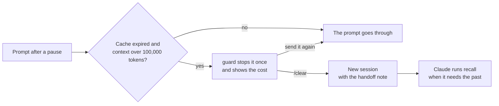

# arricurdAI

**Stop paying twice for the same context.**

Claude Code sends the whole conversation to the model again on every call. A long session reads hundreds of thousands of tokens of context each time, and after a pause of more than an hour its prompt cache has expired: the next prompt writes all of them to the cache again, at twice the input price. arricurdAI shows where your tokens go and keeps the context small without losing what was said:

- **`profile`** shows where the cost of your sessions goes.
- **`guard`** stops the costly resume of a large session after a pause, so you can start fresh instead.
- **`handoff`** gives the fresh session a short note on the old one.
- **`recall`** lets Claude search earlier sessions for what was asked, decided and changed.

Everything runs on your machine, from the transcripts Claude Code already keeps: no network calls, no telemetry, no model. The name comes from *arricurdari*, Sicilian for "to remember".

[Website](https://alessiodonato.github.io/arricurdai/) · [Get started](#get-started) · [Evidence](#evidence) · [Guide to the report](docs/guide.md)

## Why sessions get expensive

On Claude 5 models, reading a token from the prompt cache costs 0.05 of the input price, and writing it to the one-hour cache costs twice the input price.

1. **Each call reads the whole context again.** A session with 500,000 tokens of context pays about $0.10 per call with Opus 5.5, before the model writes a word.
2. **A pause empties the cache.** After more than an hour away, the next prompt writes the whole context to the cache again. That one call costs as much as reading the context forty times, and every later call still reads all of it.
3. **After a pause, starting fresh costs less.** A new session starts from the system prompt and a short note on the old one. The agent reads files again only when it needs them, so every later call is cheaper too.

Reading again what the agent already knew costs little: on three public repositories, at most 1.2% of the cost (see the [baseline](#baseline-on-public-repositories)). What costs is the size of the context, and the pauses.

## How it works

| Piece | When it runs | What it does |
| --- | --- | --- |
| [`profile`](#profile-see-where-the-tokens-go) | When you run it | The price-weighted cost of every session, the blocks of context that carry it, what compacting at other moments would have saved, memory lines never used and files read again. |
| [`guard`](#guard-no-cache-rewrite-after-a-pause) | Hook, on every prompt | When the cache of a session over 100,000 tokens has expired, it stops your first prompt once and says what going on would cost. |
| [`handoff`](#guard-no-cache-rewrite-after-a-pause) | Hook, when a session starts | After `/clear`, it gives the new session a note on the old one. It also tells every session how to run `recall`. |
| [`recall`](#recall-find-what-earlier-sessions-said) | Run by Claude | Searches the earlier sessions of the project, so that a small context does not lose what was decided. |

Coming back to a large session after a pause:

```
> What should we do next?

arricurdai: this session was idle for 19h 12m and its prompt cache expired.
Your prompt would write its 412,000 tokens of context to the cache again, about $3.30, and every later call would read them.
Run /clear to start a new session: arricurdai will give it a note on this one. Or send the prompt again to go on here.

> /clear
```

The new session starts from the system prompt and a note of at most a couple of thousand tokens, instead of 412,000 tokens of context. When Claude needs something older, it runs `recall`.



## Evidence

### Context experiment

Five steps of real work on [go-chi/chi](https://github.com/go-chi/chi) with Claude Code and Sonnet 5.5, under four ways of handling the context. Every variant passed the acceptance tests and the whole test suite.

| Variant | Cost | With a pause before each step |
| --- | --- | --- |
| One long session | $0.38 | $1.07 |
| Auto-compact at 100,000 tokens | $0.37 (−4%) | $1.02 (−4%) |
| `/compact` between steps | $0.70 (+82%) | $0.86 (−19%) |
| New session with a note | $0.48 (+25%) | **$0.64 (−40%)** |

- **After a pause, a new session with a note costs least.** It does not write the old context to the cache again, and the agent lost almost nothing: it read two files again, 813 tokens.
- **Without pauses, starting fresh or compacting costs more than it saves** on contexts this small. That is why the guard acts only after a pause, and only on large sessions.
- **The auto-compact limit never triggered.** The largest context stayed under 100,000 tokens, the smallest window Claude Code accepts. Long sessions need another run.

The prompts, the acceptance tests, the scripts and the full results are in [experiments/context](experiments/context).

### Baseline on public repositories

What does a project spend today on context it already knew? We ran five scripted Claude Code sessions on each of three well-known repositories and profiled them. The numbers use `r` = 0.1, the cache-read price before Claude 5 models.

The sessions come back to the same area of the code:

1. `/init`;
2. an explanation of the area;
3. a change, committed;
4. another change, committed;
5. a question.

They run on Sonnet, with the CLAUDE.md that `/init` wrote.

| Repository | Area | Mean cost K | Read from cache | Rediscovery | S_max | Memory share of cost | Memory lines never used |
| --- | --- | --- | --- | --- | --- | --- | --- |
| [vitejs/vite](https://github.com/vitejs/vite) (TypeScript) | hot module replacement | 58,012 | 85% | 5.8% | 1.2% | 3.4% | 20 of 34 |
| [fastapi/fastapi](https://github.com/fastapi/fastapi) (Python) | dependency injection | 53,422 | 86% | 5.7% | 0.95% | 3.5% | 14 of 23 |
| [gin-gonic/gin](https://github.com/gin-gonic/gin) (Go) | routing | 43,754 | 86% | 4.1% | 0.51% | 4.5% | 15 of 23 |

*Commits `e954a9c`, `79cab5b` and `0f09c3a`, 26 October 2026, Claude Code 2.1.310.*

What the table says:

- **In short sessions on one area, rediscovery is small.** Between 4% and 6% of the tokens read as context were already known from an earlier session, and `S_max`, the ceiling on what avoiding them could save, stays at or under 1.2% of the cost.
- **The memory costs more than the rediscovery.** CLAUDE.md, loaded in every session, takes between 3.4% and 4.5% of the cost, and more than half of its lines with something to check were never used. The lines left unused describe the build, lint and test commands, which these sessions never ran, and the parts of each codebase they never touched. In this kind of work, the larger lever is choosing which memory enters the context.
- **These are measurements of today's spend, not of savings.** Five scripted sessions per repository are an example, not a statistic. Longer projects with real histories can rediscover much more, and the profiler measures them the same way.

The prompts and the script are in [`showcase/`](showcase), with the protocol and its limits, so anyone can run them again.

## Get started

arricurdAI needs Node 20 or later and pnpm. It is not on npm yet, so build it from a clone of this repository:

```sh
git clone https://github.com/alessiodonato/arricurdai
cd arricurdai
pnpm install && pnpm build
```

In the examples below, `arricurdai` stands for `node /path/to/arricurdai/packages/cli/dist/bin.js`. Once the package is published, it will be `npx arricurdai`.

**1. Measure.** See where a project's tokens go:

```sh
arricurdai profile --project /path/to/project
```

New here? The [guide](docs/guide.md) walks through running the profiler, reading each part of the report, and what to do with what it finds.

**2. Add the hooks.** In `~/.claude/settings.json`, or in `.claude/settings.json` for one project:

```json
{
  "hooks": {
    "UserPromptSubmit": [{ "hooks": [{ "type": "command", "command": "node /path/to/arricurdai/packages/cli/dist/bin.js guard" }] }],
    "SessionStart": [{ "hooks": [{ "type": "command", "command": "node /path/to/arricurdai/packages/cli/dist/bin.js handoff" }] }]
  }
}
```

They apply to the Claude Code sessions you start afterwards.

**3. Optional: a smaller context and a longer history.**

- Start Claude Code with a lower auto-compact window, such as `CLAUDE_CODE_AUTO_COMPACT_WINDOW=200000 claude`. The [what if](#what-if) part of the report shows what it would have saved on your sessions, and `recall` finds what a compaction dropped.
- Claude Code deletes transcripts after 30 days. Set `"cleanupPeriodDays": 365` in `~/.claude/settings.json`, so that `profile` and `recall` see a longer history.

## Privacy and safety

- **Nothing leaves your machine.** arricurdAI reads the transcripts and runs `git log` locally. It makes no network call, sends no telemetry and uses no model. Each package has a test that fails if the package imports a module outside a short allowed list, so a network module would fail it.
- **It only reads your files.** `profile`, `recall` and the hooks read the transcripts. The guard keeps a small state file in the system's temporary folder.
- **The hooks let the prompt through on any problem.** The guard stops a prompt only once: send it again to go on.
- **Recall hides secrets.** Passwords, API keys, tokens and the passwords in connection strings print as `[redacted]`, so a search does not bring them into a new session.

## Profile: see where the tokens go

```
arricurdai profile [--project <path>] [--sessions <n>] [--json] [--config <file>] [--transcripts <dir>]
```

| Option | Default | What it does |
| --- | --- | --- |
| `--project <path>` | current folder | The project to profile. |
| `--sessions <n>` | 20 | How many of the most recent sessions to measure. Older sessions are still used as history, so a re-read can be recognized. |
| `--json` | | Prints the report as JSON. The schema is `reportSchema`, exported by `@arricurdai/core`. |
| `--config <file>` | `arricurdai.config.json` in the project | The cost parameters (see [Parameters](#parameters)). |
| `--transcripts <dir>` | found from the project path | The project's transcript folder, when it cannot be found automatically. |

Claude Code keeps a project's transcripts in `~/.claude/projects/<project path with every non-alphanumeric character replaced by ->/`, or under `$CLAUDE_CONFIG_DIR` when that is set.

### Example output

This is the output on the synthetic project in `fixtures/` (run `pnpm profile:fixtures` after `pnpm build`):

```
arricurdai profile · ~/code/arricurdai/fixtures/acme-shop/project
Transcripts: ~/code/arricurdai/fixtures/acme-shop/claude-home/projects/-home-dev-acme-shop

Summary
  Sessions analyzed       3  2026-09-01 → 2026-09-03
  Mean cost K             55,728 price-weighted tokens per session
  Read from cache         84% of input tokens
  Rediscovery             29% of the tokens read as context
  S_max                   0.61% of the cost: a ceiling on savings, not a promise
  Memory loaded at start  238 tokens, rent 635 per session
  Memory share of cost    1.2%
  Lines skipped           5 of 109: 3 malformed, 1 of unknown type "future-feature", 1 "assistant" with missing fields

Top rediscoveries
   #  What                                             Times    Tokens      Cost
   1  src/checkout.ts                                      3       270       621
   2  src/pricing.ts                                       1        66       172
   3  search applyDiscount @ src                           1        57       143
   4  src/db/orders.ts                                     1        42        84

Memory lines never used in the last 3 sessions
  CLAUDE.md:6  Deploy with `scripts/deploy.sh --prod` from the main branch only.
  CLAUDE.md:7  The legacy `oldCheckout()` helper is deprecated; do not call it.
  docs/conventions.md:3  Validate request bodies with `zod` at API boundaries.
  .claude/CLAUDE.md:1  Never edit generated files under `src/generated/`.
  CLAUDE.local.md:1  My local database listens on port 5433 (`docker compose up db`).
  /home/dev/.claude/projects/-home-dev-acme-shop/memory/MEMORY.md:2  [Billing webhooks](billing.md) — Stripe events arrive in `src/billing/webhook.ts`
  src/db/CLAUDE.md:1  Queries must use the `withTransaction()` wrapper from `src/db/tx.ts`.
  2 lines have nothing to check, such as a rule of style. They are listed with --json.
```

The fixtures contain broken lines on purpose. The profiler counts them in "Lines skipped" and goes on.

The report ends with a fourth part, [where the cost goes](#where-the-cost-goes). It is left out here, because the usage numbers of the fixtures are invented and do not match their content.

### How it measures

Every cost is in price-weighted tokens, that is, in units of the price of one input token. A **turn** is one API call: each call reads the whole context again, from the prompt cache.

#### Cost of a session

$$K_s = in + w \cdot cw + r \cdot cr + \mu \cdot out$$

- `in`, `cw`, `cr` and `out` are input tokens, cache writes, cache reads and output tokens, from the usage of each API call.
- A response that the transcript splits over several lines is counted once.
- `K_s` includes the session's subagents, and calls that only the session totals record, such as compaction.
- Writes to the 1-hour cache cost `w1h` instead of `w`. Claude Code main sessions write to the 1-hour cache and subagents to the 5-minute one. With `w1h = w` the formula is exactly the one above.

#### Rent of a block

A block of `c` tokens that enters the context at turn `t` of a session with `T` turns is written to the cache once, then read again on every later turn:

$$C = c \cdot (w + r \cdot (T - t))$$

A compaction drops the block from the context, so its rent stops there.

Memory that is always loaded (CLAUDE.md, MEMORY.md) enters at the first turn:

$$C_{mem} = c_{mem} \cdot (w + r \cdot (T - 1))$$

#### Rediscovery

A **context read** is a call to `Read`, `Grep` or `Glob`, or a Bash command that only reads (`cat`, `sed -n`, `head`, `tail`, `grep`, `rg`, `find`, `ls`). Its key is its kind (file, search or listing) and its target relative to the project root, so `cat src/a.ts` and `Read src/a.ts` match.

A read is a **rediscovery** when the same key was read in an earlier session of the project, and:

- for a file, the file has not changed since. The profiler checks both the edits in the transcripts and `git log` between the two reads;
- for a search or a listing, the result is identical.

A rediscovery costs the rent of its result.

#### Memory

The profiler measures the memory files Claude Code actually loaded, as the transcript records them:

- `~/.claude/CLAUDE.md`;
- `CLAUDE.md` and `CLAUDE.local.md` in the project and its parent folders;
- `.claude/CLAUDE.md` and `.claude/rules/*.md`;
- the files they import with `@`;
- the first 200 lines of the auto memory `MEMORY.md`.

For older transcripts that do not record this, it rebuilds the same list from disk and says so.

A memory line is **used** when one of its terms appears in a tool call or an assistant message of a measured session that loaded its file. The terms are code spans, paths, file names and link targets.

- Text the agent writes into a memory file, as `/init` does, is not a use.
- Lines with no such term, such as rules of style, are listed apart as "nothing to check", not as unused.

#### S_max

$$S_{max} = \frac{\sum \text{rent of rediscoveries}}{\sum K_s}$$

`S_max` is the share of the spend that went to rebuilding context from earlier sessions. It is a **ceiling**, not a promise:

- a memory that replaces a rediscovery also costs something;
- it does not count savings from pruning memory that is never used.

#### Load now or on demand

For each memory, the cost model can decide whether to load it at once or let the agent fetch it when needed. A block should be loaded now when

$$c < \frac{p \cdot (r \cdot L + overhead)}{(1 - p) \cdot (w + r \cdot (T - t))}$$

where `L` is the context already loaded and `p` the probability that the block is needed. Waiting is not free: a later fetch costs one more round trip, which reads the whole context again. The formula is `loadNowThreshold` in `@arricurdai/core`.

#### Parameters

The parameters live in `arricurdai.config.json`, in the project or wherever `--config` points. Every field is optional, and an unknown field is an error, so a typo does not go unnoticed.

| Parameter | Default | Meaning |
| --- | --- | --- |
| `w` | 1.25 | Price of writing to the 5-minute cache. |
| `w1h` | 2 | Price of writing to the 1-hour cache. |
| `r` | 0.05 | Price of reading from the cache: 0.05 for Claude 5 models, as the costs Claude Code records show. Set 0.1 for older models. |
| `mu` | 5 | Price of an output token. |
| `overhead` | 300 | Tokens of one extra round trip: the tool call, its result and the reply. |

All prices are relative to the price of one input token.

```json
{ "w1h": 2, "overhead": 400 }
```

#### Where the cost goes

The last part of the report splits the measured cost of every session among the blocks that made it up. The blocks are:

- the replies;
- the thinking;
- each tool result;
- the prompts;
- the memory files;
- the text Claude Code adds;
- the system prompt and tools.

The parts add up to the measured cost exactly:

- **Cache reads** of each call are split among the blocks already in the context, in proportion to their size. That is the rent a block pays for staying.
- **Input and cache writes** of a call go to the blocks that entered just before it.
- **Block sizes** are estimated from their text, then calibrated on how much the context really grew between two calls, which the usage measures exactly. Thinking is sized from the usage, and images from their pixels.
- **The prefix.** At the first call, what the blocks do not explain is the system prompt, tools and skills. After a compaction or a rewind, it is the context carried over.
- **A cache rebuild** is a call that wrote the previous context to the cache again instead of reading it, as happens after a pause longer than the cache lifetime. The extra cost is a line of its own.
- **Writing output** costs `mu` per token.

An example from the [showcase](showcase), five short sessions on `gin-gonic/gin`:

```
Where the cost goes
  What                                                  Tokens          Cost   Share
  Writing output                                                      58,245     27%
  Text added by Claude Code                             27,899        57,731     26%
  Tool results: Bash                                    22,794        50,619     23%
  System prompt, tools and skills                       43,830        20,467    9.4%
  Memory files                                           8,403        16,297    7.4%
  Assistant replies and tool calls                       3,977         8,274    3.8%
  Your prompts                                           1,765         4,163    1.9%
  Tool results: Read                                     1,058         2,223    1.0%
  … 2 more under 1.0% each, with --json
  Known blocks explain 100% of the cost; the rest is context the transcript does not record.

   #  Most costly blocks                                Tokens   Turn   Kept         Cost
   1  Bash: sed -n 340,410p gin.go; sed -n 685,815p…     5,300      3      2       11,662
   2  Bash: sed -n 253,420p tree.go; sed -n 420,676…     4,885      3      2       10,748
   3  Bash: ls -a; ls .github .cursor* 2>/dev/null;…     3,206      2      5        8,017
   4  Claude Code: skill_listing                         2,964      1      6        7,705
   5  Claude Code: skill_listing                         2,992      1      4        7,179
   6  System prompt, tools and skills                    9,197      1      6        6,880
   7  Claude Code: skill_listing                         2,961      1      3        5,804
   8  Claude Code: skill_listing                         3,494      1      2        5,666
   9  Claude Code: skill_listing                         3,025      1      2        5,535
  10  System prompt, tools and skills                    8,661      1      4        4,864
  Turn: the API call where the block entered the context. Kept: the calls that read it again.
```

In sessions this short, most of the cost is output, the commands' results and the text Claude Code adds to every session. The list of skills alone is about 3,000 tokens. In long interactive sessions the picture changes:

- blocks stay in the context for hundreds of calls;
- thinking stays in the context too;
- every pause longer than the cache lifetime writes the whole context again, at the price of a cache write.

#### What if

When sessions are long, the report replays them with compactions at other moments, to show what the context size costs:

- **Compact before each pause.** Before every cache rebuild, while the cache is still warm. This is what you could do by running `/compact` before a long break.
- **Compact when coming back from a pause.** At every cache rebuild, reading the cold context at the cache-write price.
- **Keep the context under 200,000 or 400,000 tokens.** Compact whenever a request would pass that size, as a lower auto-compact window would.

How the replay works:

- **A simulated compaction** keeps the system prompt and a summary as large as the real summaries of the project, or 15,000 tokens if there is none. It costs a read of the context and the writing of the summary.
- **The calls that follow** bring the same new content as the real ones, with a smaller context.
- **These are ceilings.** A compaction drops detail the agent may have to read again, and that cost is not counted.

#### What is approximate

- Token counts are estimates: characters / 4, computed in one function (`estimateTokens`) so that a tokenizer can replace it.
- A Bash command that reads several files splits its output evenly among them.
- git only sees committed changes. A file edited outside Claude Code and never committed looks unchanged. Without git, the report says so.
- Only rediscoveries across sessions are counted, not re-reads within one session.
- The breakdown assumes every block stays until the next compaction or rewind. Claude Code can also clear old blocks on its own, which the transcript does not record.
- Costs are in price-weighted tokens of each call's own model. A session that switches model mixes prices, and starts again from an empty cache.
- The transcript format belongs to Claude Code and is not documented. [docs/transcript-schema.md](docs/transcript-schema.md) records what was observed in versions 2.1.301 and 2.1.310. Lines the parser does not understand are counted and skipped.

## Guard: no cache rewrite after a pause

The prompt cache keeps the context of a main session for an hour. After a longer pause, the next prompt writes the whole context to the cache again, at twice the input price, and every later call reads it. In long sessions these rewrites are a large part of the cost. In the [context experiment](#context-experiment), with a pause before each step, a new session per step with a short note cost 40% less than one long session, and both passed the same tests.

Two hooks act on it:

- **`arricurdai guard`** runs when you send a prompt. If the cache of a session larger than 100,000 tokens has expired, it stops the prompt once and says what going on would cost. Run `/clear` to start fresh, or send the prompt again to go on. `--min-tokens <n>` changes the smallest session worth stopping for.
- **`arricurdai handoff`** runs when a session starts. After that `/clear`, it gives the new session a note on the old one, built from the transcript without a model: the last requests, the files changed, the open tasks and the last reply. It adds up to three passages of earlier sessions that match the prompt you were about to send, about 800 tokens at most. In every new session, and after a compaction, it adds one line on how to run [`recall`](#recall-find-what-earlier-sessions-said).

The settings are in [Get started](#get-started). Both hooks read local files only, and on any problem they let the prompt through.

## Recall: find what earlier sessions said

A small context is cheaper, but the agent loses what it no longer sees. `arricurdai recall` lets it look that up:

```sh
arricurdai recall "invoice vat foreign customers" --project /path/to/project
```

Claude runs it on its own: the handoff hook tells every new session how. It searches the earlier Claude Code sessions of the project and prints the few passages that match. Each passage comes from one of these:

- a request with the replies to it;
- the files changed after the request;
- a part of a compaction summary.

How it works:

- **The search is lexical (BM25), without a model.** It reads local files only.
- **Matches across word forms.** It folds singular and plural in Italian and English, so `fattura` finds `fatture`, and it splits identifiers such as `MethodAllowList`.
- **What it leaves out.**
  - Tool results: the files they show can be read again.
  - The current session: when Claude Code runs the command, it already has that session.
- **Hides secrets.** Passwords, API keys, tokens and the passwords in connection strings print as `[redacted]`, so a search does not bring them into a new session. The same goes for the passages that the note after `/clear` adds.

| Option | Default | What it does |
| --- | --- | --- |
| `--limit <n>` | 5 | The most passages to show. |
| `--max-tokens <n>` | 1500 | The most tokens to print. The first passage is always printed. |
| `--json` | | Prints the passages as JSON. |
| `--project <path>`, `--transcripts <dir>` | current folder | As for `profile`. |

Limits:

- **It sees only the transcripts Claude Code keeps.** By default Claude Code deletes them after 30 days. To search further back, raise `cleanupPeriodDays` in `~/.claude/settings.json`.
- **It works best with precise words.** It finds names, paths, errors and technical terms well. It does less well with vague questions.
- **It always prints the best matches it has.** With a vague query, they can be only loosely related.

## Roadmap

- **Done:** `profile`; `guard` and `handoff`; `recall`, which hides secrets.
- **Next:**
  - in the note after `/clear`, only passages that match the prompt well; compaction summaries split on whole lines;
  - measurements on long real sessions with a lower auto-compact window;
  - an npm package with a setup command.

## Development

```sh
pnpm install
pnpm build   # tsup builds the JavaScript, tsc checks types and writes declarations
pnpm test    # type checks and Vitest, for every package
```

| Path | Contents |
| --- | --- |
| `packages/core` | The cost model and the measures: pure functions, and the zod schemas of the config and the report. |
| `packages/transcripts` | The tolerant parser of Claude Code transcripts. |
| `packages/cli` | The `arricurdai` command, the hooks, recall and the git history. |
| `fixtures/` | Synthetic transcripts, with the expected results in [fixtures/README.md](fixtures/README.md). |
| `showcase/` | The scripted sessions behind the baseline on public repositories. |
| `experiments/` | The context experiment on go-chi/chi. |
| `docs/` | The website, the guide and the transcript schema. |

## License

[Apache-2.0](LICENSE)
